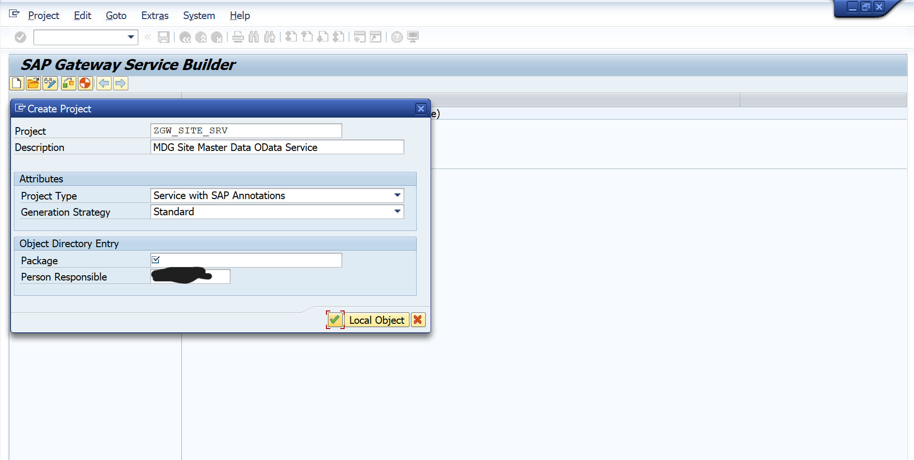
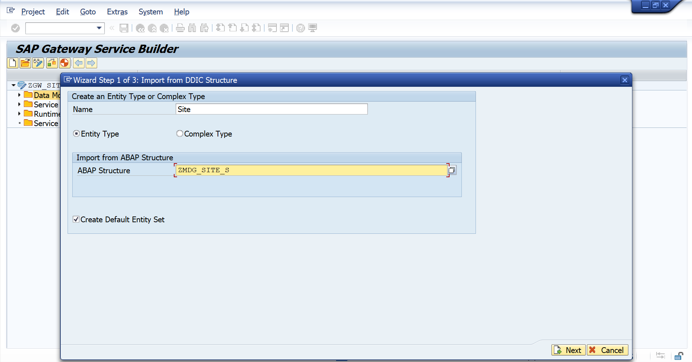
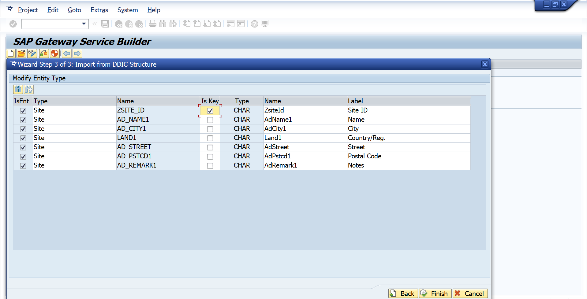
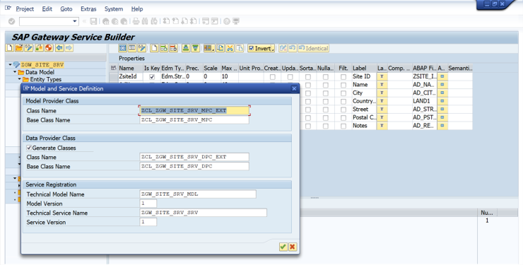
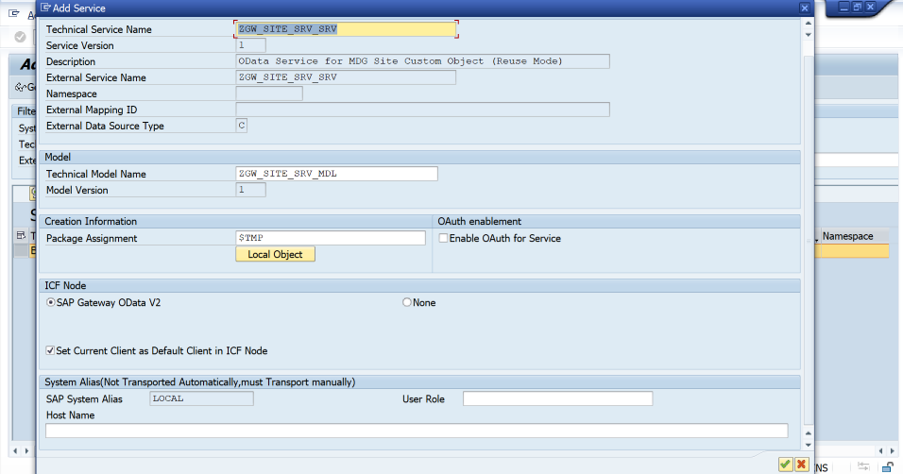
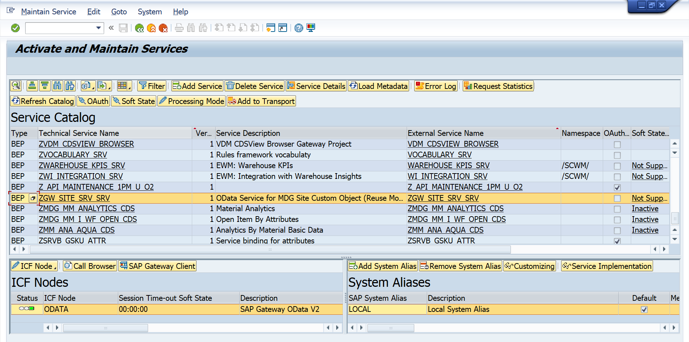

# Phase 1: OData Project Creation in SEGW & Service Activation

## Overview

In this phase, we create the SAP Gateway OData project in transaction **SEGW**, import the custom DDIC structure `ZMDG_SITE_S` (created in [Part 1](https://github.com/E2cyber/sap-mdg-custom-site-reuse-mode/blob/main/docs/01-ddic-objects.md)), generate the runtime artifacts, and register/activate the OData service in `/IWFND/MAINT_SERVICE`.

---

## 1.1 Create OData Project in SEGW

### Step 1: Create Project
1. Open transaction **SEGW** (SAP Gateway Service Builder)
2. Click the **Create Project** icon in the top toolbar
3. Enter the following details:
   - **Project:** `ZGW_SITE_SRV`
   - **Description:** `MDG Site Master Data OData Service`
   - **Generation Strategy:** Standard
   - **Package:** `$TMP` (or your transportable package)
4. Click **Continue** (Enter) and **Save**

---

## 1.2 Import DDIC Structure to Create Entity & Entity Set

### Step 1: Import DDIC Structure `ZMDG_SITE_S`
1. Expand the project tree **`ZGW_SITE_SRV`**
2. Right-click on **Data Model** → **Import** → **DDIC Structure**
3. Enter the following details:
   - **Name:** `Site`
   - **ABAP Structure:** `ZMDG_SITE_S`
   - **Create Default Entity Set:** Checked (`SiteSet`)
4. Click **Next**

---

### Step 2: Select Fields and Mark Key Property
1. Select all 7 fields from `ZMDG_SITE_S` (`ZSITE_ID`, `AD_NAME1`, `AD_CITY1`, `LAND1`, `AD_STREET`, `AD_PSTCD1`, `AD_REMARK1`) and click **Next**
2. Check the **Is Key** checkbox for **`ZSITE_ID` (`ZsiteId`)**
3. Click **Finish** and **Save**

---

## 1.3 Generate Runtime Artifacts

### Step 1: Generate Objects
1. Click the **Generate Runtime Objects** icon (red & white wheel) in the top toolbar
2. Confirm the default generated class names in the popup:
   - **Model Provider Base Class:** `ZCL_ZGW_SITE_SRV_MPC`
   - **Model Provider Extension Class:** `ZCL_ZGW_SITE_SRV_MPC_EXT`
   - **Data Provider Base Class:** `ZCL_ZGW_SITE_SRV_DPC`
   - **Data Provider Extension Class:** `ZCL_ZGW_SITE_SRV_DPC_EXT`
   - **Technical Service Name:** `ZGW_SITE_SRV_SRV`
3. Click **Continue** and save to your package (`$TMP`)

---

## 1.4 Register and Activate the Service in `/IWFND/MAINT_SERVICE`

### Step 1: Add Service
1. Open transaction **`/n/IWFND/MAINT_SERVICE`**
2. Click the **Add Service** button in the top toolbar
3. Enter:
   - **System Alias:** `LOCAL`
   - **Technical Service Name:** `ZGW_SITE_SRV_SRV*`
4. Click **Get Services**
5. Select **`ZGW_SITE_SRV_SRV`** and click **Add Selected Services**
6. Assign the package (`$TMP` / Local Object) and click **Continue**

---

### Step 2: Verify Service Registration
1. Return to the main screen of **`/n/IWFND/MAINT_SERVICE`**
2. Locate **`ZGW_SITE_SRV_SRV`** in the service catalog
3. Verify that the **ICF Node (`ODATA`)** shows a green active status icon

---

**Next Step:** [Phase 2: Redefining OData CRUD Methods in `DPC_EXT`](02-dpc-ext-implementation.md)
