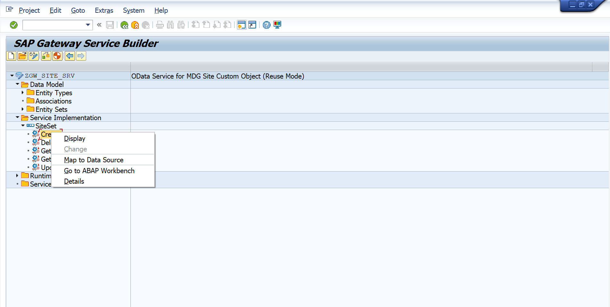
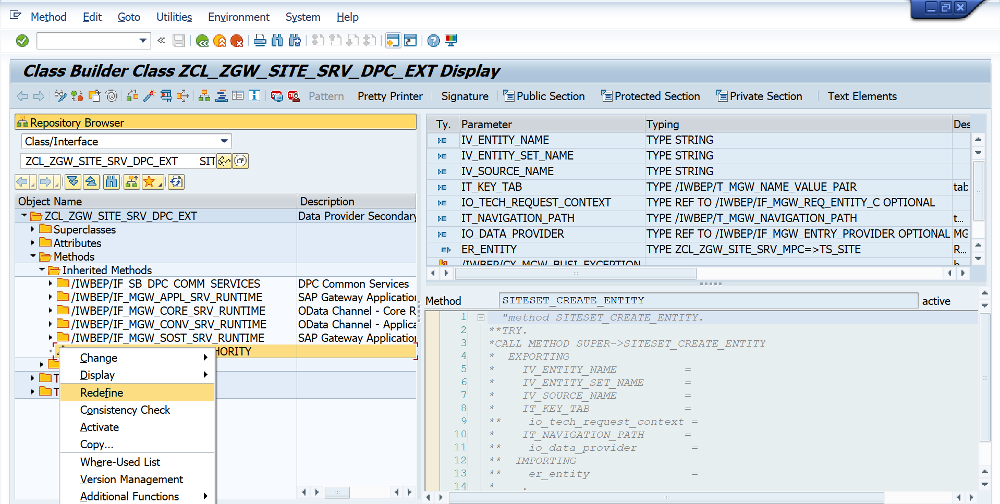

# Phase 2: Service Implementation & Redefining CRUD Methods

## Overview

In this phase, we navigate from **Service Implementation** inside our **SEGW** project (`ZGW_SITE_SRV`) to the ABAP Workbench, redefine the 5 CRUD methods for `SiteSet`, implement the backend logic, and activate the methods.

---

## 2.1 Implement `Create` (`SITESET_CREATE_ENTITY`)

### Step 1: Navigate to ABAP Workbench from SEGW
1. Open transaction **SEGW** and expand project **`ZGW_SITE_SRV`**
2. Expand **Service Implementation** → expand **`SiteSet`**
3. Right-click on **`Create`** and select **Go to ABAP Workbench**
   *(If an information popup appears stating the method is not yet implemented, click **Continue**)*



---

### Step 2: Redefine `SITESET_CREATE_ENTITY`
1. In the Class Builder screen (`ZCL_ZGW_SITE_SRV_DPC_EXT`), expand the **Methods** folder → expand **Inherited Methods**
2. Locate **`SITESET_CREATE_ENTITY`**
3. Right-click on **`SITESET_CREATE_ENTITY`** and select **Redefine**



---

### Step 3: Enter Code and Activate
1. Double-click on **`SITESET_CREATE_ENTITY`** (now listed under the **Redefinitions** folder)
2. Enter the ABAP code for the `Create` method:

```abap
" Paste your SITESET_CREATE_ENTITY code here
```

3. Click **Save** (`Ctrl+S`) and **Activate** (`Ctrl+F3`)

---

## 2.2 Implement `Delete` (`SITESET_DELETE_ENTITY`)

### Step 1: Redefine `SITESET_DELETE_ENTITY`
1. In `ZCL_ZGW_SITE_SRV_DPC_EXT`, under **Methods** → **Inherited Methods**, locate **`SITESET_DELETE_ENTITY`**
   *(Or from SEGW: **Service Implementation** → **`SiteSet`** → right-click **`Delete`** → **Go to ABAP Workbench**)*
2. Right-click on **`SITESET_DELETE_ENTITY`** and select **Redefine**

---

### Step 2: Enter Code and Activate
1. Double-click on **`SITESET_DELETE_ENTITY`** under **Redefinitions**
2. Enter the ABAP code for the `Delete` method:

```abap
" Paste your SITESET_DELETE_ENTITY code here
```

3. Click **Save** (`Ctrl+S`) and **Activate** (`Ctrl+F3`)

---

## 2.3 Implement `GetEntity (Read)` (`SITESET_GET_ENTITY`)

### Step 1: Redefine `SITESET_GET_ENTITY`
1. Under **Methods** → **Inherited Methods**, locate **`SITESET_GET_ENTITY`**
2. Right-click on **`SITESET_GET_ENTITY`** and select **Redefine**

---

### Step 2: Enter Code and Activate
1. Double-click on **`SITESET_GET_ENTITY`** under **Redefinitions**
2. Enter the ABAP code for reading a single Site record:

```abap
" Paste your SITESET_GET_ENTITY code here
```

3. Click **Save** (`Ctrl+S`) and **Activate** (`Ctrl+F3`)

---

## 2.4 Implement `GetEntitySet (Query)` (`SITESET_GET_ENTITYSET`)

### Step 1: Redefine `SITESET_GET_ENTITYSET`
1. Under **Methods** → **Inherited Methods**, locate **`SITESET_GET_ENTITYSET`**
2. Right-click on **`SITESET_GET_ENTITYSET`** and select **Redefine**

---

### Step 2: Enter Code and Activate
1. Double-click on **`SITESET_GET_ENTITYSET`** under **Redefinitions**
2. Enter the ABAP code for querying the Site entity set:

```abap
" Paste your SITESET_GET_ENTITYSET code here
```

3. Click **Save** (`Ctrl+S`) and **Activate** (`Ctrl+F3`)

---

## 2.5 Implement `Update` (`SITESET_UPDATE_ENTITY`)

### Step 1: Redefine `SITESET_UPDATE_ENTITY`
1. Under **Methods** → **Inherited Methods**, locate **`SITESET_UPDATE_ENTITY`**
2. Right-click on **`SITESET_UPDATE_ENTITY`** and select **Redefine**

---

### Step 2: Enter Code and Activate
1. Double-click on **`SITESET_UPDATE_ENTITY`** under **Redefinitions**
2. Enter the ABAP code for the `Update` method:

```abap
" Paste your SITESET_UPDATE_ENTITY code here
```

3. Click **Save** (`Ctrl+S`) and **Activate** (`Ctrl+F3`) to activate the entire class **`ZCL_ZGW_SITE_SRV_DPC_EXT`**.

---

**Next Step:** [Phase 3: Gateway Client Testing & Fixing CSRF Token Validation in SICF](03-gateway-testing-csrf-fix.md)
```

---

Let me know once you finish **Phase 2 (`docs/02-dpc-ext-implementation.md`)**, and we will move to **Phase 3**!+]
