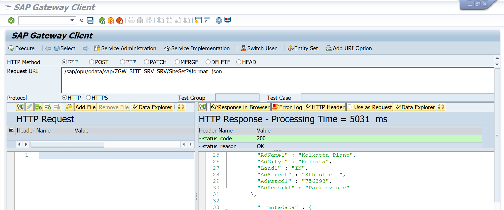
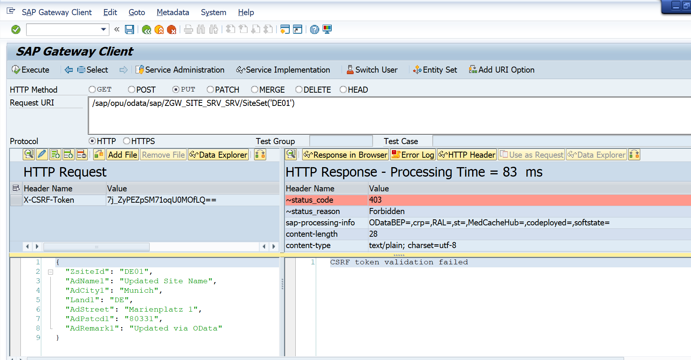
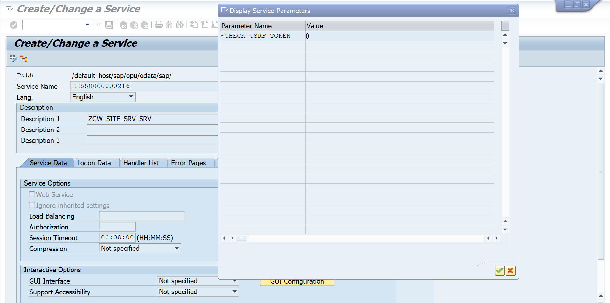
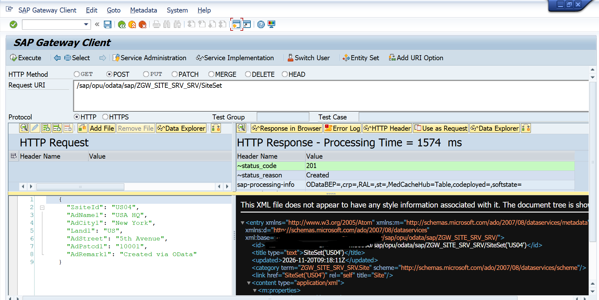

# Phase 3: Gateway Client Testing & Fixing CSRF Token Validation in SICF

## Overview

In this phase, we test our OData service (`ZGW_SITE_SRV_SRV`) in **SAP Gateway Client** (`/IWFND/GW_CLIENT`), resolve the `403 Forbidden: CSRF token validation failed` error in transaction **SICF**, and verify `GET`, `POST`, `PUT`, and `DELETE` operations.

---

## 3.1 Test `GET` Operations in `/IWFND/GW_CLIENT`

### Step 1: Test `GET_ENTITYSET` (Fetch All Sites)
1. Open transaction **`/n/IWFND/GW_CLIENT`**
2. Select HTTP Method: **`GET`**
3. Enter Request URI:
   ```text
   /sap/opu/odata/sap/ZGW_SITE_SRV_SRV/SiteSet?$format=json
   ```
4. Click **Execute (F8)**
5. Verify that the response returns **`~status_code: 200 OK`** along with all active Site records from `YMDG_SITE`:



---

### Step 2: Test `GET_ENTITY` (Fetch Single Site)
1. Keep HTTP Method as **`GET`**
2. Enter Request URI:
   ```text
   /sap/opu/odata/sap/ZGW_SITE_SRV_SRV/SiteSet('DE01')?$format=json
   ```
3. Click **Execute (F8)** and verify the single Site record is returned.

---

## 3.2 Resolve `403 Forbidden: CSRF token validation failed` in SICF

### The Issue
When testing `POST`, `PUT`, or `DELETE` requests over `HTTP` in `/IWFND/GW_CLIENT`, SAP Gateway returns **`~status_code: 403 Forbidden`** with the message **`CSRF token validation failed`**:



---

### Step-by-Step Fix in Transaction `SICF`

1. Open transaction **`/nSICF`**
2. In **Service Path**, enter:
   ```text
   /sap/opu/odata/sap/zgw_site_srv_srv
   ```
3. Click **Execute (F8)**
4. Double-click on the **`zgw_site_srv_srv`** service node
5. Click the **Display <-> Change (Pencil)** icon in the top toolbar
6. Under the **Service Data** tab, click the **`GUI Configuration`** button
7. Add the following service parameter:
   - **Parameter Name:** `~CHECK_CSRF_TOKEN`
   - **Value:** `0`



8. Click **Continue** (green checkmark) and click **Save**

---

## 3.3 Test `POST`, `PUT`, and `DELETE` Operations

### Step 1: Test `CREATE_ENTITY` (`POST`)
1. Return to transaction **`/n/IWFND/GW_CLIENT`**
2. Select HTTP Method: **`POST`**
3. Enter Request URI:
   ```text
   /sap/opu/odata/sap/ZGW_SITE_SRV_SRV/SiteSet
   ```
4. In the **HTTP Request** header section, make sure the header is set to:
   - **Header Name:** `Content-Type`
   - **Value:** `application/json; charset=utf-8`
5. Enter the JSON payload in the Request Body:
   ```json
   {
     "ZsiteId": "US04",
     "AdName1": "USA HQ",
     "AdCity1": "New York",
     "Land1": "US",
     "AdStreet": "5th Avenue",
     "AdPstcd1": "10001",
     "AdRemark1": "Created via OData"
   }
   ```
6. Click **Execute (F8)**
7. Verify that the response returns **`~status_code: 201 Created`**:



---

### Step 2: Test `UPDATE_ENTITY` (`PUT`)
1. Select HTTP Method: **`PUT`**
2. Enter Request URI:
   ```text
   /sap/opu/odata/sap/ZGW_SITE_SRV_SRV/SiteSet('DE01')
   ```
3. Keep the `Content-Type: application/json; charset=utf-8` header and enter the updated JSON body:
   ```json
   {
     "ZsiteId": "DE01",
     "AdName1": "Germany HQ Updated",
     "AdCity1": "Berlin",
     "Land1": "DE",
     "AdStreet": "2nd street",
     "AdPstcd1": "700000",
     "AdRemark1": "Updated via OData CR"
   }
   ```
4. Click **Execute (F8)** and verify **`~status_code: 204 No Content`**.

---

### Step 3: Test `DELETE_ENTITY` (`DELETE`)
1. Select HTTP Method: **`DELETE`**
2. Enter Request URI:
   ```text
   /sap/opu/odata/sap/ZGW_SITE_SRV_SRV/SiteSet('TEST01')
   ```
3. Clear the Request Body and click **Execute (F8)**
4. Verify **`~status_code: 204 No Content`**.

---

**Next Step:** [Phase 4: Deploying the SAPUI5 Application to ABAP Repository (`SE38` & `SE80`)](04-fiori-app-deployment.md)
```

