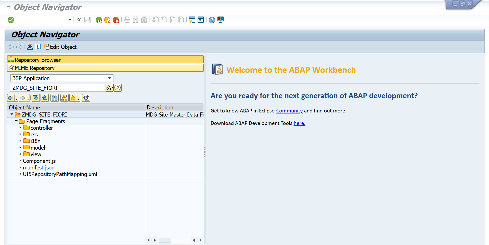

# Phase 4: Deploying the SAPUI5 Application to ABAP Repository (`SE38` & `SE80`)

## Overview

In this phase, we upload our custom SAPUI5 frontend application (`fiori-app/`) from the local file system into the SAP ABAP BSP Repository as **`ZMDG_SITE_FIORI`** using standard report **`/UI5/UI5_REPOSITORY_LOAD`** in transaction **SE38**, verify the uploaded structure in transaction **SE80**, activate the SICF service, and calculate the UI5 application index.

---

## 4.1 Prepare the Local `fiori-app` Folder

1. Ensure all frontend files (`Component.js`, `manifest.json`, `controller/`, `css/`, `i18n/`, `model/`, `view/`) are placed inside a local folder without spaces in the path (for example: `C:\fiori-app\`).
2. Verify that `manifest.json` points to the registered OData service URI `/sap/opu/odata/sap/ZGW_SITE_SRV_SRV/`.
   *(All complete frontend source files are available in the [`/fiori-app`](../fiori-app) folder of this repository).*

---

## 4.2 Upload SAPUI5 Application via `/UI5/UI5_REPOSITORY_LOAD` (`SE38`)

### Step 1: Execute Report `/UI5/UI5_REPOSITORY_LOAD`
1. Open transaction **`/nSE38`**
2. Enter Program: **`/UI5/UI5_REPOSITORY_LOAD`** and click **Execute (F8)**
3. Enter the following details on the selection screen:
   - **Name of SAPUI5 Application:** `ZMDG_SITE_FIORI`
   - Select Radio Button: **`Upload`**
4. Click **Execute (F8)**

---

### Step 2: Select Folder and Complete Upload
1. In the folder browser dialog, select your local **`C:\fiori-app`** folder and click **OK**
2. On the upload preview screen, scroll to the bottom and enter:
   - **Description:** `MDG Site Master Data Fiori App`
   - **Package:** `$TMP` (or your transportable package)
   - **External Codepage:** ` `
3. Click **Continue** (green checkmark)
4. Verify that all files are uploaded and the log displays **`* Upload finished *`**:

---

## 4.3 Verify Uploaded BSP Application in `SE80`

### Step 1: Check BSP Application `ZMDG_SITE_FIORI`
1. Open transaction **`/nSE80`**
2. Click **Repository Browser**
3. Select **`BSP Application`** from the dropdown list
4. Enter **`ZMDG_SITE_FIORI`** and press **Enter**
5. Expand **`ZMDG_SITE_FIORI`** → expand **`Page Fragments`**
6. Verify that all folders (`controller`, `css`, `i18n`, `model`, `view`) and root files (`Component.js`, `manifest.json`) are present and active:



---

## 4.4 Activate SICF Service & Calculate Application Index

### Step 1: Verify SICF Service Node
1. Open transaction **`/nSICF`**
2. In **Service Path**, enter:
   ```text
   /sap/bc/ui5_ui5/sap/zmdg_site_fiori
   ```
3. Click **Execute (F8)**
4. Verify that the **`zmdg_site_fiori`** node is active (if grayed out, right-click on `zmdg_site_fiori` and select **Activate Service**)

---

### Step 2: Recalculate SAPUI5 Application Index
1. Open transaction **`/nSE38`**
2. Enter Program: **`/UI5/APP_INDEX_CALCULATE`** and click **Execute (F8)**
3. Select **Single SAPUI5 Repository Only** and enter **`ZMDG_SITE_FIORI`**
4. Click **Execute (F8)**

---

**Next Step:** [Phase 5: Fiori Launchpad Tile, Catalog & Role Configuration (`PFCG`)](05-flp-tile-and-role-setup.md)
```
