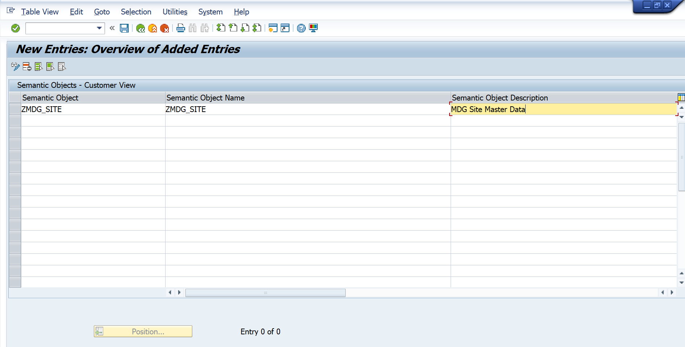
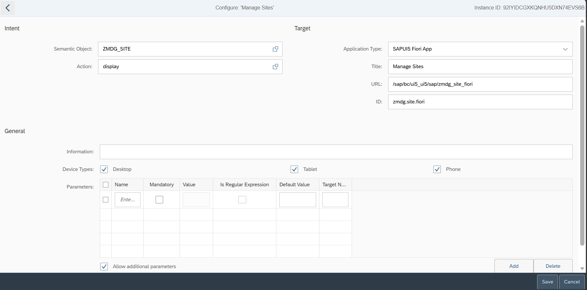
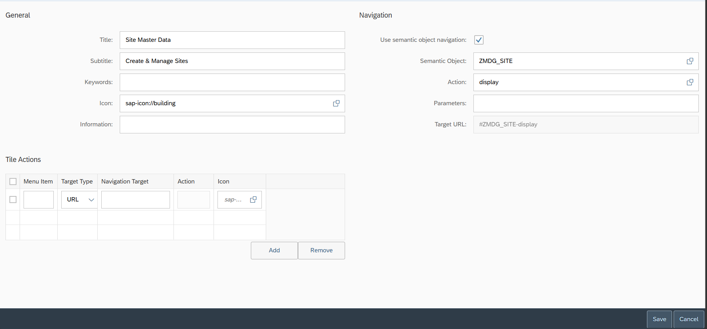
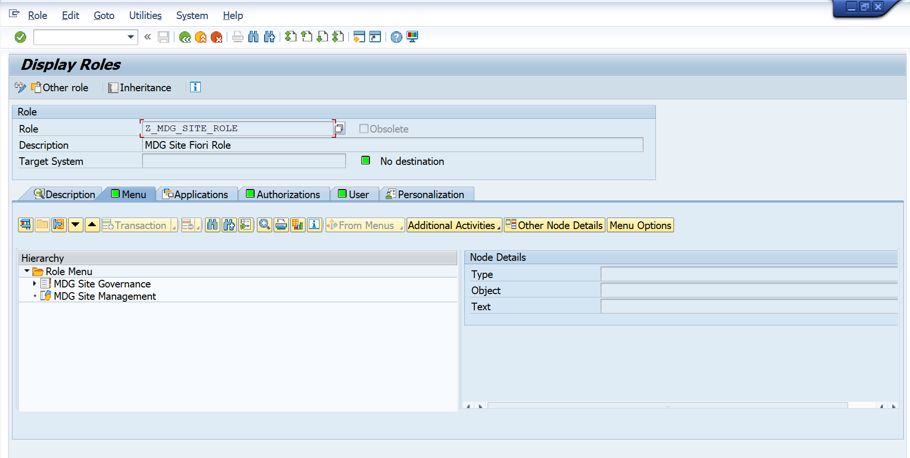
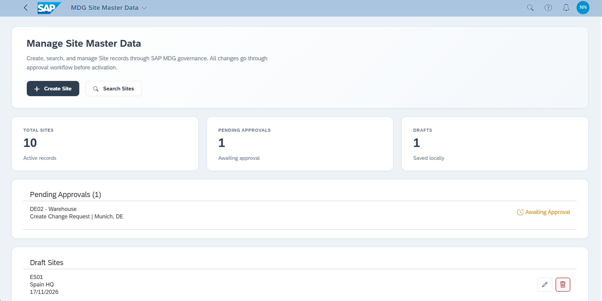
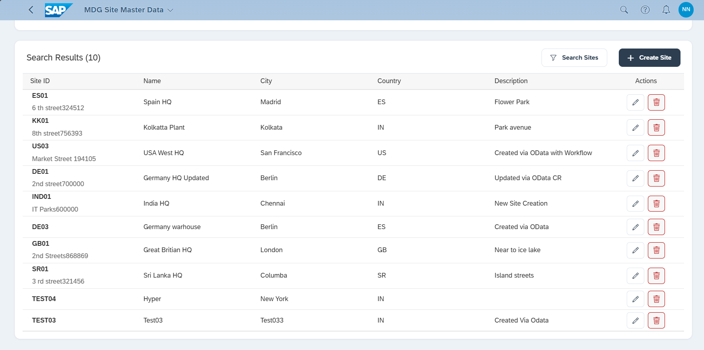

# Phase 5: Fiori Launchpad Tile, Catalog & Role Configuration (`PFCG`)

## Overview

In this phase, we create a custom Semantic Object, configure the Fiori Launchpad Catalog, Target Mapping, Static Tile, and Group in the Fiori Launchpad Designer (`/UI2/FLPD_CUST`), assign them to a role in transaction **PFCG**, and test our application on the **SAP Fiori Launchpad** (`/UI2/FLP`).

---

## 5.1 Create Semantic Object in `/UI2/SEMOBJ`

### Step 1: Define Semantic Object
1. Open transaction **`/n/UI2/SEMOBJ`**
2. Click **Display <-> Change** (Pencil icon)
3. Click **New Entries** and enter the following details:
   - **Semantic Object:** `ZMDG_SITE`
   - **Semantic Object Name:** `ZMDG_SITE`
   - **Semantic Object Description:** `MDG Site Master Data`
4. Click **Save**

---

## 5.2 Configure Catalog, Target Mapping, Tile & Group in `/UI2/FLPD_CUST`

### Step 1: Create Catalog
1. Open transaction **`/n/UI2/FLPD_CUST`** (opens the Fiori Launchpad Designer in your browser)
2. Ensure the **Catalogs** tab is selected on the top left
3. Click the **`+` (Create Catalog)** button at the bottom left and enter:
   - **Title:** `MDG Site Governance`
   - **ID:** `Z_MDG_SITE_CAT`
4. Click **Save**

---

### Step 2: Create Target Mapping
1. Select your catalog **`MDG Site Governance`** → click the **Target Mappings** tab in the top bar
2. Click **Create Target Mapping** at the bottom right
3. Enter the following details:
   - **Semantic Object:** `ZMDG_SITE`
   - **Action:** `display`
   - **Application Type:** `SAPUI5 Fiori App`
   - **Title:** `MDG Site Master Data`
   - **URL:** `/sap/bc/ui5_ui5/sap/zmdg_site_fiori`
   - **ID:** `zmdg.site.fiori` *(matches the component `"id"` in `manifest.json`)*
4. Click **Save**

---

### Step 3: Create Static Tile
1. Switch to the **Tiles** tab inside catalog `Z_MDG_SITE_CAT`
2. Click **`+` (Create Tile)** → select **App Launcher # Static**
3. Enter the following details:
   - **Title:** `MDG Site Master Data`
   - **Subtitle:** `Create & Manage Sites`
   - **Icon:** `sap-icon://building`
   - **Use semantic object navigation:** Checked
   - **Semantic Object:** `ZMDG_SITE`
   - **Action:** `display`
4. Click **Save**

---

### Step 4: Create Fiori Tile Group
1. Switch to the **Groups** tab at the top left of the Launchpad Designer
2. Click **`+` (Create Group)** at the bottom left and enter:
   - **Title:** `MDG Site Management`
   - **ID:** `Z_MDG_SITE_GRP`
3. Click **Save**
4. Under **Show as Tiles**, click the **`+` (Add Tile)** box
5. Select catalog **`MDG Site Governance (Z_MDG_SITE_CAT)`** and click the **`+`** icon below your `MDG Site Master Data` tile to add it to the group

---

## 5.3 Create PFCG Role & Assign to User

### Step 1: Create Role and Add Catalog & Group
1. Open transaction **`/nPFCG`**
2. Enter Role: **`Z_MDG_SITE_ROLE`** and click **Single Role**
3. Enter Description: `MDG Site Fiori Role` and click **Save**
4. Go to the **Menu** tab:
   - Click the small arrow next to **`+ Transaction`** → select **SAP Fiori Tile Catalog** → enter **`Z_MDG_SITE_CAT`** → click **Continue**
   - Click the small arrow next to **`+ Transaction`** → select **SAP Fiori Tile Group** → enter **`Z_MDG_SITE_GRP`** → click **Continue**

---

### Step 2: Generate Authorizations and Assign User
1. Go to the **Authorizations** tab → click **Change Authorization Data**
2. Click the **Generate** icon (`Shift+F5`) to generate the profile, then click **Back** (`F3`)
3. Go to the **User** tab → enter your SAP User ID in the table
4. Click **User Comparison** → **Complete Comparison** → click **Save**

---

## 5.4 Test the Application in SAP Fiori Launchpad (`/UI2/FLP`)

1. Open transaction **`/n/UI2/FLP`** to launch the SAP Fiori Launchpad in your browser
2. Locate the **MDG Site Management** group and click the **MDG Site Master Data** tile
3. Verify the application loads with live Site records from `YMDG_SITE`, search filters, local draft storage, and real-time pending approval tracking:

4. Test **Create Site**, **Edit Site**, and **Delete Site**—each operation creates an SAP MDG Change Request (`ZKCREATE`) and starts workflow `WS46000027`. Once approved in SAP MDG, the changes automatically reflect in `YMDG_SITE` and update the Fiori dashboard.
